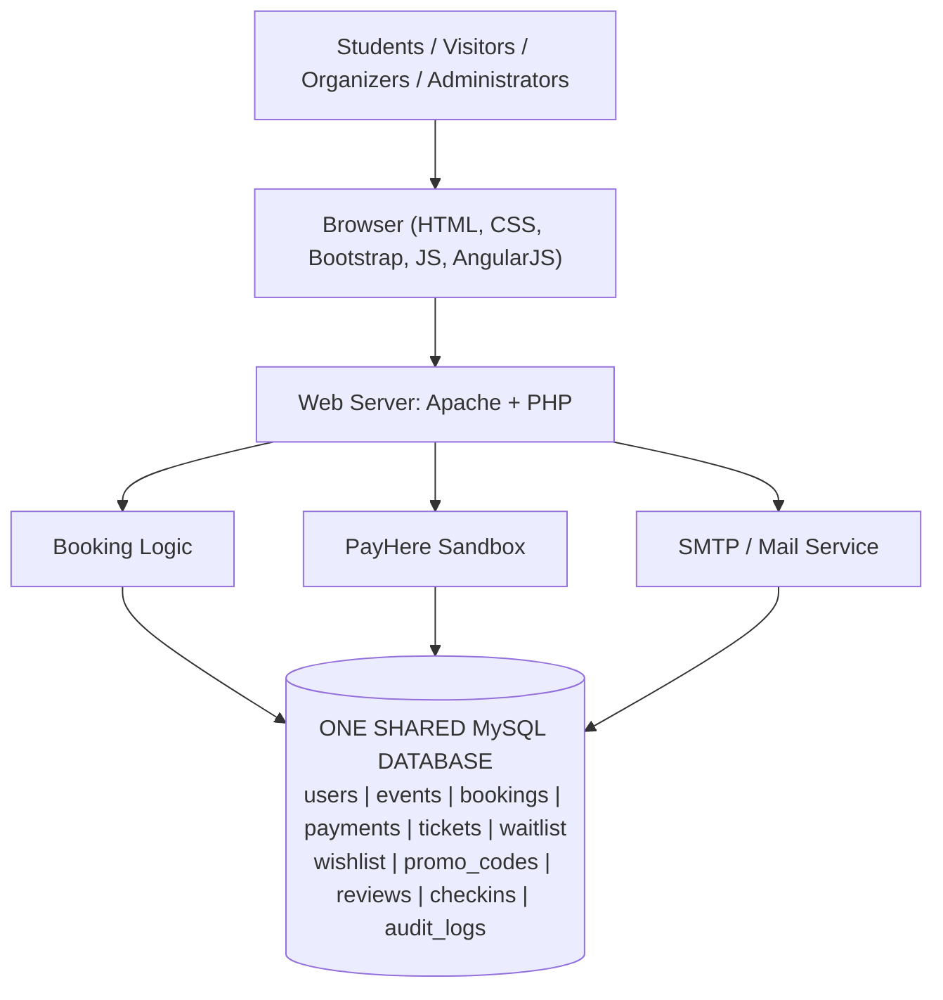
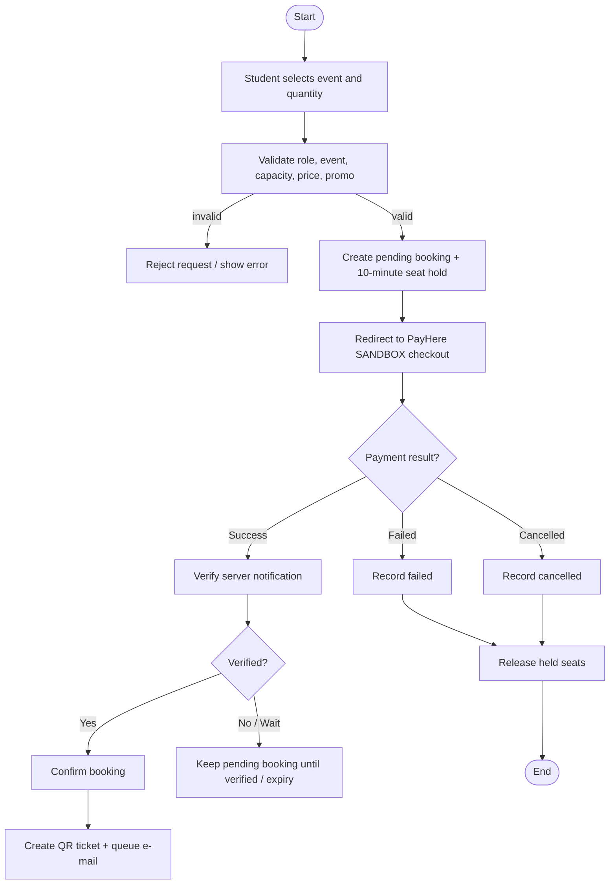
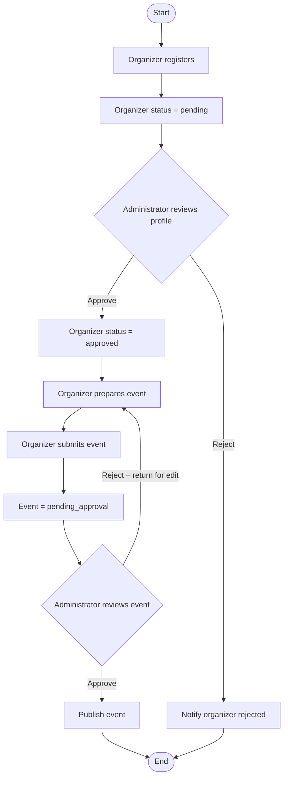
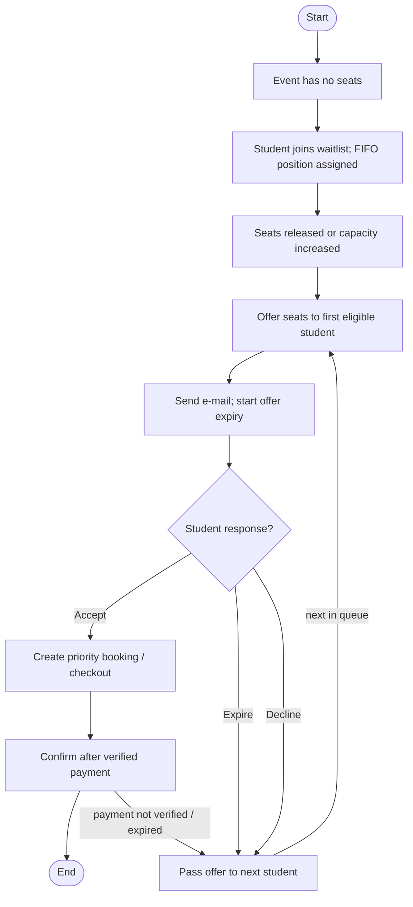
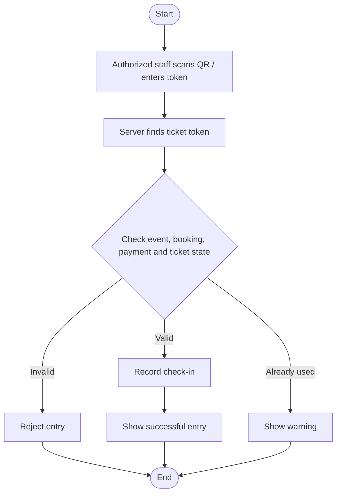
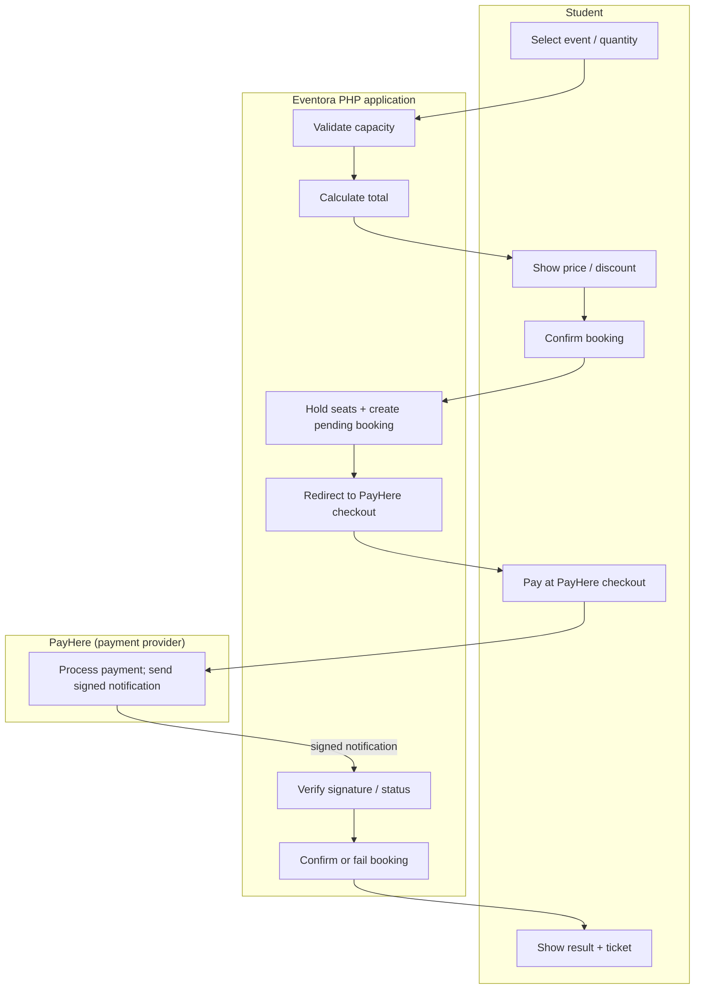
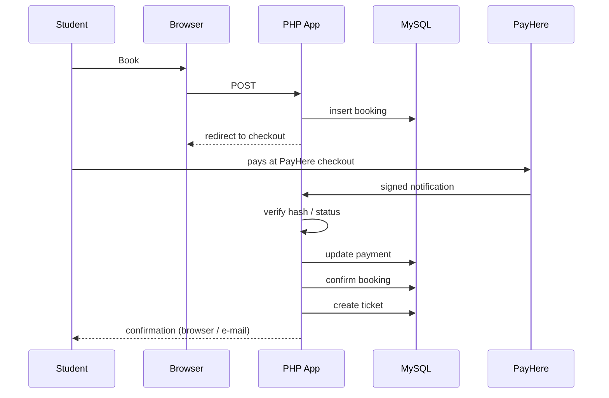
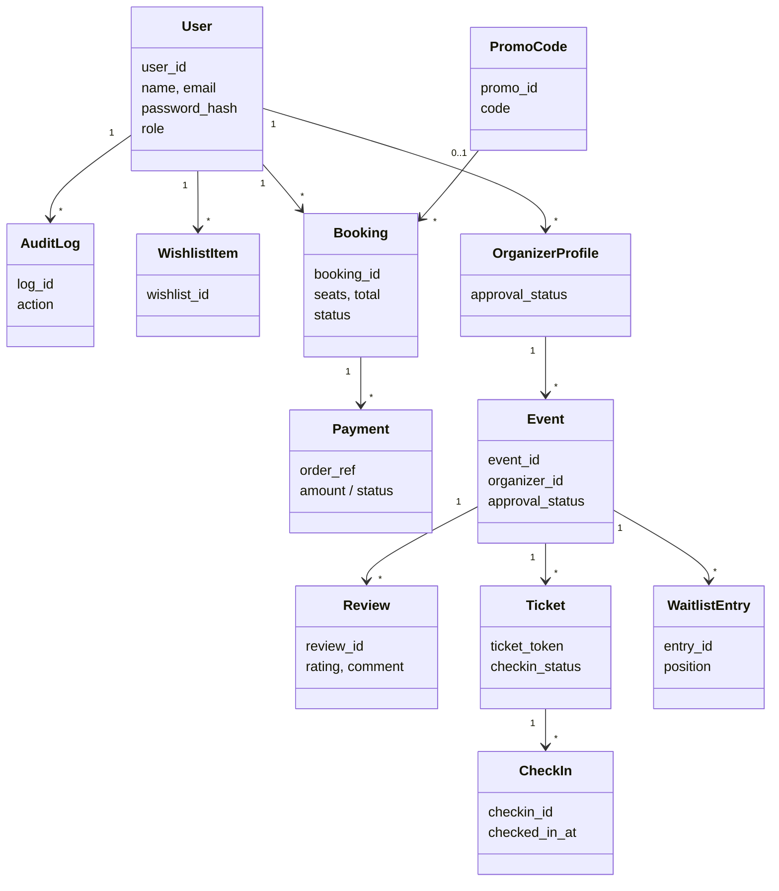

# Software Requirements Specification for Eventora

**Campus Event Booking System** · Version 1.0

Faculty of Computing and Information Technology | NIIBS

Prepared by: A. U. Vidanapathirana (ITBSC/2025/EA/WD/003)

---

## Table of Contents

1. [Introduction](#1-introduction)
2. [Overall Description](#2-overall-description)
3. [Use Cases](#3-use-cases)
4. [Functional Requirements](#4-functional-requirements)
5. [Business Rules](#5-business-rules)
6. [Non-Functional Requirements](#6-non-functional-requirements)

---

## 1. Introduction

### 1.1 Purpose

The purpose of this Software Requirements Specification (SRS) is to outline the functional and non-functional requirements for Eventora, a web application for publishing campus events and managing student reservations.

### 1.2 Scope

Eventora will provide users with the ability to search for events happening on campus. Registered students will have the ability to reserve and manage their seat bookings. Organizers will be able to submit and manage their own events (subject to approval). Administrators will be able to manage the platform and view all activity within the system. Bookings will be made using the PayHere sandbox (only during development and assessment).

This application will be developed as a traditional PHP web application. HTML5, CSS3, JavaScript, Bootstrap 5, AngularJS and PHP will be used. All data will be stored in a single MySQL database. The modules will use individual tables within the database. Email notifications will be sent using Gmail SMTP via PHPMailer.

#### 1.2.1 In-scope capabilities

- Public browsing, searching, filtering, sorting and viewing of events.
- Student registration, login/logout, role-based access and student profile information.
- Booking seats, managing capacity, bulk discounts, booking history and cancelling.
- PayHere sandbox payments, payment statuses and payment history.
- Booking confirmation emails and event reminders.
- QR code electronic tickets and one-time check-in.
- FIFO waiting lists for events with no capacity and student wishlists.
- Promo codes and different discount types that can be configured with clear discount stacking rules.
- Multiple organisers, event ownership and approval/rejection by administrators.
- Event reviews and ratings with eligibility rules.
- Administrator and organiser dashboards with charts, filtered reports and CSV exporting.
- Git version control, testing, documentation and implementation.

### 1.3 Definitions and Abbreviations

| Term | Meaning |
|---|---|
| Visitor | Unauthenticated person who can browse public events. |
| Student | Registered user who can book seats, join waitlists, maintain a wishlist and submit eligible reviews. |
| Organizer | Approved account allowed to create and manage events assigned to that organizer; submitted events require approval. |
| Administrator | Privileged account that manages users, organizers, events, bookings, promotions and reports. |
| Booking | A student's reservation for one or more seats at an event. |
| Payment | A transaction attempt for a booking, processed through PayHere sandbox. |
| QR ticket | A ticket containing a unique, non-guessable token encoded as a QR code. |
| Waitlist | Ordered queue of students requesting seats after an event reaches capacity. |
| Promo code | A code that applies a configured discount when its conditions are met. |
| Check-in | The recorded validation and use of a ticket at the event venue. |
| LKR | Sri Lankan rupee. |
| SRS / FR / NFR / BR / UC | Software Requirements Specification / Functional Requirement / Non-Functional Requirement / Business Rule / Use Case. |

---

## 2. Overall Description

### 2.1 Product Perspective and Architecture

Eventora is a single web application with a browser-based front end, PHP application layer and one relational database. The browser communicates with PHP pages and JSON endpoints over HTTP. PHP validates authorization and business rules, communicates with the PayHere sandbox and mail service, and reads/writes the shared MySQL database.

**Figure 1. Logical system architecture**



### 2.2 Product Functions

- Discover upcoming events and view event details.
- Register and authenticate students, organizers and administrators.
- Submit, approve, publish, edit and cancel events.
- Reserve seats, calculate discounts and complete sandbox payments.
- Notify users by e-mail and issue QR tickets after successful confirmation.
- Allow students to join a waitlist, save favourite events and manage bookings.
- Validate tickets at the venue and prevent duplicate check-in.
- Collect eligible reviews and ratings after events.
- Provide role-appropriate dashboards, reports, charts and CSV downloads.

### 2.3 User Classes

| User class | Main permissions |
|---|---|
| Visitor | Browse events, view event details, register and login. |
| Student | All Visitor functions, plus booking and payment, viewing personal bookings and cancelling, waiting list, wish list, ticketing, check-in history and reviews. |
| Organizer (pending) | View own organizer profile and approval status but cannot publish or manage live events until approved. |
| Organizer (approved) | Create and submit events, edit own permitted events, view bookings for own events, scan/validate tickets for assigned events and view own event reports. |
| Administrator | Manage all users and roles, approve organizers/events, manage all events/bookings/promotions, configure rules and view system-wide reports. |

### 2.4 Operating Environment

- Server: Apache, PHP and MySQL.
- Client: current Chrome, Firefox and Edge on desktop and mobile.
- Front end: HTML5, CSS3, JavaScript, Bootstrap 5 and AngularJS.
- Server-side data access: PHP PDO with prepared statements.
- Time zone: Asia/Colombo. Currency: LKR.

### 2.5 Constraints

- The project must demonstrate HTML, CSS, JavaScript, Bootstrap, AngularJS, PHP, arrays, functions, loops and Git.
- All application entities must reside in one MySQL database. Separate logical tables are allowed.
- Payment testing must use PayHere sandbox credentials and sandbox endpoints. No live charges shall be made.
- Server-side validation and authorization are authoritative; client-side checks are usability aids only.

---

## 3. Use Cases

### 3.1 Use Case Diagram

**Figure 2. Use case diagram** (Eventora Web Application)

| Actor | Use cases |
|---|---|
| Visitor | Browse / search events, View event details, Register, Log in |
| Student | Book seats, Pay, View / cancel bookings, Join / leave waitlist, Manage wishlist, View QR ticket, Submit review, View e-mails |
| Organizer | Submit / edit own event, View own bookings, View own reports, Check in ticket |
| Administrator | Approve organizers / events, Manage all events, Manage promo codes, Manage bookings / users, View reports, Export CSV, Configure system |

External systems and included use cases:

- **Pay** «includes» **Process payment** → PayHere Sandbox (payment gateway).
- **Register**, **Book seats**, **Join / leave waitlist**, **Approve organizers / events** «include» **Send e-mail (PHPMailer)** → Gmail SMTP via PHPMailer.

### 3.2 Use Case Summary

| ID | Use case | Actor | Description |
|---|---|---|---|
| UC-01 | Browse/search events | Visitor, Student | Search, filter and view upcoming events. |
| UC-02 | Register/login/logout | Visitor, Student, Organizer, Admin | Create an account and authenticate. |
| UC-03 | Submit/approve event | Organizer, Admin | The event is submitted by the organizer and approved/rejected by admin. |
| UC-04 | Book seats | Student | Validate availability, discounts and booking limits. |
| UC-05 | Pay for booking | Student, PayHere | Complete sandbox checkout and confirm payment status. |
| UC-06 | Receive ticket/notifications | Student, Mail service | Send confirmation/reminders and issue QR ticket. |
| UC-07 | Cancel booking | Student, Organizer/Admin | Cancel eligible booking and update seat/payment states. |
| UC-08 | Join/leave waitlist | Student | Join FIFO queue for sold-out event and withdraw. |
| UC-09 | Manage wishlist | Student | Add/remove favourite events. |
| UC-10 | Check in attendee | Organizer, Admin | Validate QR token and mark ticket used once. |
| UC-11 | Manage promotions | Administrator | Create and maintain promo codes and discount rules. |
| UC-12 | Review event | Student | Submit rating and review after attendance. |
| UC-13 | View/export reports | Organizer, Admin | View charts and download authorized CSV reports. |

### 3.3 Detailed Use Case: UC-04 Book and Pay

| Field | Description |
|---|---|
| Primary actor | Student |
| Preconditions | The student has been authenticated, the event has been approved, published and can be booked. There are available seats and a valid number of bookings. |
| Main flow | 1. Student selects event and quantity.<br>2. System displays price and applicable discounts.<br>3. Student optionally enters a promo code.<br>4. PHP recalculates total and temporarily holds seats.<br>5. Student is redirected to PayHere sandbox.<br>6. PayHere processes the test payment.<br>7. PayHere server notification is verified by PHP.<br>8. System confirms booking, records payment, creates QR ticket and queues confirmation e-mail. |
| Alternative flows | I. Invalid promo: show reason and allow correction.<br>II. Payment cancelled/failed: mark payment failed and release held seats.<br>III. Delayed notification: don't issue a confirmed ticket, keep the payment pending until it can be confirmed.<br>IV. Duplicate notification: process idempotently. |
| Postconditions | If payment is successful then there will be a confirmed booking with an active ticket. If payment fails or times out then capacity won't be lost. |

### 3.4 Detailed Use Case: UC-03 Organizer Event Approval

| Field | Description |
|---|---|
| Primary actor | Organizer. Administrator is the approving actor. |
| Preconditions | Organizer account exists but organizer must be approved to submit an event for review. |
| Main flow | 1. Organizer completes event form.<br>2. PHP validates required fields and stores event with `pending_approval` status.<br>3. Administrator reviews details.<br>4. Administrator approves or rejects with an optional reason.<br>5. Approved event becomes published when publication conditions are satisfied.<br>6. Organizer receives an e-mail notification. |
| Alternative flows | I. Unapproved organizer cannot submit a publishable event.<br>II. Rejected event remains editable by its owner and can be resubmitted.<br>III. Unauthorized organizer cannot edit another organizer's event. |
| Postconditions | Event status and approval decision are stored in the shared database with reviewer and timestamp. |

### 3.5 Detailed Use Case: UC-10 Venue Check-in

| Field | Description |
|---|---|
| Primary actor | Approved organizer or administrator |
| Preconditions | Event is active and within its check-in window. Ticket belongs to the event and has not been used. |
| Main flow | 1. Staff opens authorized check-in screen.<br>2. QR code is scanned or token is entered.<br>3. Server looks up token and verifies booking/payment/event status.<br>4. Server records check-in time and staff user.<br>5. Screen displays valid/used/invalid result. |
| Alternative flows | I. Unknown token, unpaid booking, cancelled ticket or wrong event is rejected.<br>II. Previously checked-in ticket is flagged as already used. |
| Postconditions | One check-in record exists for the ticket; duplicate use is prevented by a unique constraint and transaction. |

---

## 4. Functional Requirements

Priority: **M** = Must, **S** = Should.

### 4.1 Authentication and Roles

| ID | Requirement | Priority |
|---|---|---|
| FR-AUTH-001 | The system shall allow a visitor to register a student account using name, unique e-mail and password. | M |
| FR-AUTH-002 | The system shall hash passwords and verify them. | M |
| FR-AUTH-003 | The system shall support student, organizer and administrator roles, with server-side authorization on every protected action. | M |
| FR-AUTH-004 | Organizer registration shall create a pending organizer profile; an administrator shall approve or reject it before organizer privileges are enabled. | M |
| FR-AUTH-005 | The system shall regenerate the session ID after successful login and destroy the session on logout. | M |
| FR-AUTH-006 | The system shall prevent self-registration as administrator. Administrator accounts shall be seeded or created by an authorized administrator. | M |
| FR-AUTH-007 | The system shall enforce ownership so organizers can access only their own events and associated booking data. | M |

### 4.2 Event Discovery and Event Management

| ID | Requirement | Priority |
|---|---|---|
| FR-EVT-001 | The public event list shall show approved, published and upcoming events ordered by start date. | M |
| FR-EVT-002 | AngularJS shall load event data from a PHP JSON endpoint and render the list without a full page reload. | M |
| FR-EVT-003 | Users shall be able to search by keyword and filter by category and date, and active filters shall combine using AND logic. | M |
| FR-EVT-004 | Users shall be able to sort events by date and price. | S |
| FR-EVT-005 | Event details shall show title, description, category, venue, date/time, price, capacity, availability and organizer/publication status as appropriate. | M |
| FR-EVT-006 | An approved organizer shall be able to create and edit events they own and submit changes for approval where configured. | M |
| FR-EVT-007 | An administrator shall be able to approve, reject, publish, suspend, cancel and archive any event. | M |
| FR-EVT-008 | The system shall record the approving administrator, decision, decision timestamp and rejection reason for each approval decision. | M |
| FR-EVT-009 | The system shall reject event-capacity changes that would make capacity lower than seats already committed or held. | M |
| FR-EVT-010 | The system shall hide unpublished, rejected, suspended and cancelled events from the public event list. | M |

### 4.3 Booking and Seat Management

| ID | Requirement | Priority |
|---|---|---|
| FR-BKG-001 | A logged-in student shall be able to request a whole-number seat quantity within the configured per-student and event availability limits. | M |
| FR-BKG-002 | PHP shall recalculate subtotal, eligible discounts and total; client-provided totals shall never be trusted. | M |
| FR-BKG-003 | The system shall create a pending-payment booking and a time-limited seat hold for a paid event before redirecting to checkout. | M |
| FR-BKG-004 | The system shall use a database transaction and conditional capacity update to prevent overselling under concurrent requests. | M |
| FR-BKG-005 | The system shall confirm a paid booking only after a valid PayHere server notification or other trusted payment verification. | M |
| FR-BKG-006 | For free events, the system shall confirm the booking without invoking PayHere and shall issue the ticket immediately. | M |
| FR-BKG-007 | Students shall be able to view only their own bookings, payment statuses and tickets. | M |
| FR-BKG-008 | Students shall be able to cancel eligible bookings before the configured cancellation deadline; capacity shall be released transactionally. | M |
| FR-BKG-009 | The system shall show booking reference, event, seats, itemized discounts, total and payment status after submission. | M |
| FR-BKG-010 | The system shall expire abandoned pending-payment holds and release the held seats automatically. | M |

### 4.4 PayHere Sandbox Payments

| ID | Requirement | Priority |
|---|---|---|
| FR-PAY-001 | The system shall initiate checkout using PayHere's sandbox environment only during development and assessment. | M |
| FR-PAY-002 | The system shall send the required merchant, order, amount, currency, customer and return/cancel/notify details according to the configured PayHere integration specification. | M |
| FR-PAY-003 | The system shall store a unique local order reference and associate it with exactly one booking and payment attempt. | M |
| FR-PAY-004 | The server notification endpoint shall verify the PayHere signature/hash using the merchant secret stored outside public web files. | M |
| FR-PAY-005 | The system shall update payment status only from a verified server-side notification or an explicitly verified server-side status check, not from the browser return page alone. | M |
| FR-PAY-006 | The payment notification handler shall be idempotent; repeated notifications for the same transaction shall not create duplicate confirmations or tickets. | M |
| FR-PAY-007 | The system shall record transaction reference, order reference, amount, currency, status, response code and timestamps. | M |
| FR-PAY-008 | Failed, cancelled or expired payments shall not produce active tickets and shall release the associated seat hold when safe to do so. | M |
| FR-PAY-009 | The interface shall clearly identify the integration as sandbox/test mode and shall not collect or store card numbers, CVV or other card credentials. | M |
| FR-PAY-010 | The system shall display a clear pending state when payment verification has not yet been received. | M |

### 4.5 E-mail Confirmation and Reminders

| ID | Requirement | Priority |
|---|---|---|
| FR-MAIL-001 | After booking confirmation, the system shall queue or send an e-mail containing booking reference, event details, paid amount and ticket access link. | M |
| FR-MAIL-002 | The system shall send a reminder at a configurable interval before the event, with a default of 24 hours. | S |
| FR-MAIL-003 | The system shall prevent duplicate reminder messages for the same booking and reminder schedule. | M |
| FR-MAIL-004 | The system shall record recipient, template/type, queued/sent/failed status, attempt count and timestamps. | M |
| FR-MAIL-005 | Mail delivery failure shall not reverse a confirmed booking; failed messages shall be logged for retry or administrator review. | M |

### 4.6 QR E-Tickets and Venue Check-in

| ID | Requirement | Priority |
|---|---|---|
| FR-TKT-001 | For each confirmed booking, the system shall issue a unique ticket token; tickets shall not be issued for failed or pending payments. | M |
| FR-TKT-002 | The system shall display a QR code encoding an opaque, non-sequential ticket token and provide a printable ticket view. | M |
| FR-TKT-003 | The system shall allow an authorized organizer or administrator to scan a QR code or enter its token to validate entry. | M |
| FR-TKT-004 | The server shall verify ticket status, event association, booking status and payment status before check-in. | M |
| FR-TKT-005 | A ticket shall be checked in at most once; a repeated scan shall display an "Already checked in" result. | M |
| FR-TKT-006 | The system shall record check-in time, ticket, event and staff account in the shared database. | M |
| FR-TKT-007 | Authorized staff shall be able to search attendees and manually check in a valid ticket when camera scanning is unavailable. | S |

### 4.7 Waitlist and Wishlist

| ID | Requirement | Priority |
|---|---|---|
| FR-WAIT-001 | A logged-in student shall be able to join the waitlist for an eligible sold-out event. | M |
| FR-WAIT-002 | The system shall maintain waitlist order by join timestamp and process the queue on a first-in, first-out basis. | M |
| FR-WAIT-003 | When seats become available, the system shall offer them to the next eligible waitlisted student and notify that student by e-mail. | M |
| FR-WAIT-004 | A waitlist offer shall have a configurable expiry period; expired or declined offers shall pass to the next student. | M |
| FR-WAIT-005 | A student shall be able to leave a waitlist; the system shall prevent duplicate active entries for the same student and event. | M |
| FR-WISH-001 | A logged-in student shall be able to add an event to and remove an event from their personal wishlist. | M |
| FR-WISH-002 | The wishlist shall list saved events with current date, status and availability; unavailable events shall be clearly labelled. | S |

### 4.8 Promo Codes and Discounts

| ID | Requirement | Priority |
|---|---|---|
| FR-PROMO-001 | An administrator shall be able to create, edit, activate, deactivate and expire promo codes. | M |
| FR-PROMO-002 | A promo code shall support percentage or fixed-amount discounts, validity dates, minimum spend, maximum discount, total-use limit and per-user use limit where configured. | M |
| FR-PROMO-003 | The system shall validate a promo code on the server before applying it and shall show a clear reason when it is invalid or ineligible. | M |
| FR-PROMO-004 | The system shall store the applied code and discount amount in the booking so later code edits do not alter historical bookings. | M |
| FR-PROMO-005 | Discounts shall not stack by default; the system shall apply the single best eligible discount according to the configured priority rule. | M |
| FR-PROMO-006 | The system shall prevent promo-code use beyond configured global and per-user limits, including concurrent checkout attempts. | M |

### 4.9 Multiple Organizers and Approval Workflow

| ID | Requirement | Priority |
|---|---|---|
| FR-ORG-001 | The system shall support multiple organizer accounts, each with an individual organizer profile and approval status. | M |
| FR-ORG-002 | An administrator shall approve or reject organizer access and record the decision and reason. | M |
| FR-ORG-003 | An approved organizer shall be able to create event drafts and submit them for administrator approval. | M |
| FR-ORG-004 | Only approved and published events shall appear in the public event list. | M |
| FR-ORG-005 | Organizers shall view bookings and reports only for events they own or are explicitly assigned to manage. | M |
| FR-ORG-006 | An administrator shall be able to suspend an organizer. Suspended organizers shall lose event-management access. | M |
| FR-ORG-007 | The system shall preserve an approval history for organizer and event decisions. | S |

### 4.10 Event Reviews and Ratings

| ID | Requirement | Priority |
|---|---|---|
| FR-REV-001 | A student shall be able to submit one rating per eligible attended event. | M |
| FR-REV-002 | A review shall be accepted only when the student has a confirmed booking and a recorded check-in for that event. | M |
| FR-REV-003 | The system shall validate rating values within the configured scale of 1 to 5 and enforce review text length limits. | M |
| FR-REV-004 | The public event detail page shall display the average rating and approved reviews, where available. | S |
| FR-REV-005 | An administrator shall be able to hide or restore reviews that violate the club's review policy; the action shall be logged. | S |

### 4.11 Reports, Charts and CSV Export

| ID | Requirement | Priority |
|---|---|---|
| FR-REP-001 | The administrator dashboard shall show event counts, booking counts, revenue totals, payment statuses, attendance and waitlist counts. | M |
| FR-REP-002 | An organizer shall see report data only for events they own or are assigned to manage. | M |
| FR-REP-003 | Reports shall support date-range and event/category filters where applicable. | M |
| FR-REP-004 | The system shall display visual summaries such as bookings by event, revenue over time and attendance rate. | S |
| FR-REP-005 | Authorized users shall be able to export filtered report data as CSV. | M |
| FR-REP-006 | CSV export shall use the same access scope and filters as the on-screen report and shall safely escape values to reduce spreadsheet formula injection risk. | M |

### 4.12 Validation and Audit

| ID | Requirement | Priority |
|---|---|---|
| FR-VAL-001 | All user forms shall provide client-side validation and clear field-level feedback. | M |
| FR-VAL-002 | PHP shall repeat all security- and business-critical validation on the server. | M |
| FR-VAL-003 | State-changing requests shall use CSRF protection and reject invalid or missing tokens. | M |
| FR-AUD-001 | The system shall record important administrative actions, approval decisions, payment state changes and check-in actions with actor and timestamp. | M |

---

## 5. Business Rules

| ID | Rule |
|---|---|
| BR-01 | Each account has one role: student, organizer or administrator. Public visitors are unauthenticated. |
| BR-02 | An event cannot have more confirmed or temporarily held seats than its capacity. |
| BR-03 | A sold-out event has no immediately available seats but a waitlist may be enabled. |
| BR-04 | A student may hold at most 10 active seats for one event, unless the administrator changes the configured limit. |
| BR-05 | The original bulk discount is retained: 10% off the seat subtotal for bookings of five or more seats. It is configurable. |
| BR-06 | Only approved, published, active and future events may accept new bookings. |
| BR-07 | A booking is confirmed only after verified payment for a paid event; a free event may be confirmed immediately. |
| BR-08 | Pending-payment seat holds expire after 10 minutes by default; expiry releases seats in a transaction. |
| BR-09 | Money is stored as DECIMAL(10,2), currency is LKR, and calculations are rounded to two decimal places. |
| BR-10 | All event date/time values are interpreted in Asia/Colombo. |
| BR-11 | A promo code must be active, within its validity window and satisfy all configured conditions. |
| BR-12 | Discount stacking is disabled by default. The system applies one eligible discount only; the selected rule and amount are stored on the booking. |
| BR-13 | Waitlist offers are FIFO and expire after 30 minutes by default; these values are configurable. |
| BR-14 | Only an approved organizer may submit events; only an administrator may approve or reject organizer accounts and event submissions. |
| BR-15 | An organizer may access only events assigned to that organizer; administrators may access all events. |
| BR-16 | A QR ticket is valid only for its associated confirmed booking and verified payment, and can be checked in once. |
| BR-17 | Only a student with a confirmed booking and a recorded check-in may review an event; one review per student per event. |
| BR-18 | Cancellation/refund handling depends on payment status and configured cancellation policy. Sandbox refund capability must be verified before being promised; manual admin handling may be used for the assignment. |
| BR-19 | All payment callbacks are verified and idempotent; browser redirects alone do not establish payment success. |
| BR-20 | A booking's stored unit price, discounts, promo code and total are historical snapshots and are not recalculated after event or promotion edits. |

### 5.1 Pricing Calculation

```text
subtotal = unit_price × quantity
discount = single permitted discount (bulk or promo, per the non-stacking rule), rounded to 2 decimal places
total    = subtotal − discount
```

The system calculates the eligible bulk discount and promo discount according to the configured non-stacking rule, selects the single permitted discount, rounds the discount to two decimal places and calculates the total. The final amount sent to PayHere must match the server-side booking amount.

### 5.2 Payment and Seat-Hold Lifecycle

**Figure 3. Booking/payment flowchart**



### 5.3 Organizer/Event Approval Flow

**Figure 4. Organizer and event approval flowchart**



### 5.4 Waitlist Flow

**Figure 5. Waitlist flowchart**



### 5.5 Ticket Check-in Flow

**Figure 6. QR check-in flowchart**



### 5.6 UML Activity Diagram: Event Booking

**Figure 7. UML activity diagram (booking)** — swimlanes: Student, Eventora PHP application, PayHere (payment provider).



### 5.7 UML Sequence Diagram: Payment Notification

**Figure 8. UML sequence diagram (payment)**



### 5.8 UML Class Diagram

**Figure 9. UML class diagram (conceptual)**



---

## 6. Non-Functional Requirements

| ID | Requirement | Priority |
|---|---|---|
| NFR-USA-001 | All pages shall be responsive from 360 px mobile width to desktop without horizontal scrolling. | M |
| NFR-USA-002 | Navigation, colours, buttons, form layouts and feedback messages shall be consistent. | M |
| NFR-USA-003 | Pages shall use semantic HTML, accessible labels, alt text and logical heading order. | M |
| NFR-SEC-001 | Passwords shall be hashed. Secrets and payment credentials shall not be stored in source control or exposed to browsers. | M |
| NFR-SEC-002 | All user-supplied database values shall use PDO prepared statements. | M |
| NFR-SEC-003 | User-supplied output shall be escaped to prevent cross-site scripting. | M |
| NFR-SEC-004 | Role and ownership checks shall run on the server for every protected page, API and action. | M |
| NFR-SEC-005 | State-changing forms and endpoints shall use CSRF protection where applicable. | M |
| NFR-SEC-006 | PayHere notifications shall be cryptographically verified. Duplicate callbacks shall be safe to process. | M |
| NFR-SEC-007 | Ticket tokens shall be generated using a cryptographically secure random generator and shall not be guessable. | M |
| NFR-SEC-008 | The system shall not collect or store card numbers, CVV or online banking credentials. | M |
| NFR-SEC-009 | CSV exports shall neutralize formula-leading cells and restrict export access by role and ownership. | M |
| NFR-REL-001 | Booking, cancellation, payment reconciliation and check-in updates shall use database transactions where multiple records change. | M |
| NFR-REL-002 | The system shall prevent overselling and duplicate check-in under concurrent requests. | M |
| NFR-REL-003 | Failure of e-mail delivery shall not invalidate a successful booking or payment. | M |
| NFR-PER-001 | For a local test dataset of up to 200 events, event list and filter interactions should complete within 2 seconds under normal conditions. | M |
| NFR-PER-002 | Common dashboard queries should complete within 3 seconds for the assignment-scale test dataset, excluding network delays. | S |
| NFR-COMP-001 | The system shall work in current Chrome, Firefox and Edge desktop/mobile browsers. | M |
| NFR-LOC-001 | Prices shall be displayed in LKR with two decimal places and dates in Asia/Colombo time. | M |
| NFR-MNT-001 | PHP code shall be separated into reusable includes, API, admin, organizer, assets and setup folders. | M |
| NFR-MNT-002 | Business rules shall be implemented in named PHP functions and configuration arrays rather than duplicated across pages. | M |
| NFR-MNT-004 | README shall document setup, database import, seed accounts, PayHere sandbox configuration, mail setup and scheduled tasks. | M |
| NFR-AUD-001 | Approval decisions, payment state changes and check-in actions shall be traceable to an actor and timestamp. | M |
| NFR-PRV-001 | Only information needed for event booking and administration shall be collected. Personal details shall not be embedded in QR codes. | M |
