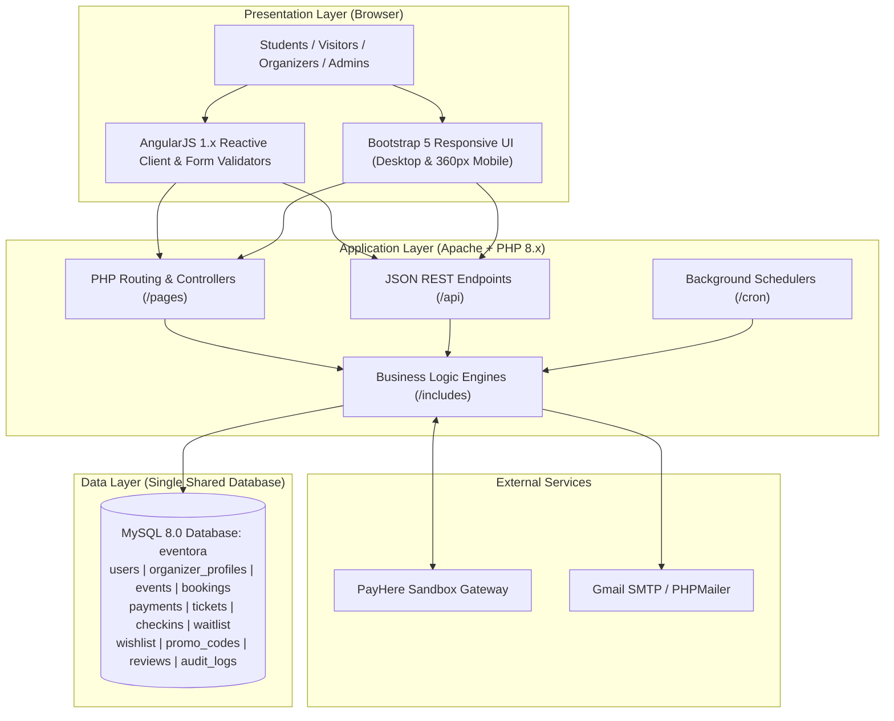

# Eventora — Campus Event Booking System

[](Eventora_SRS.md)
[](https://www.php.net/)
[](https://www.mysql.com/)
[](https://getbootstrap.com/)
[](https://angularjs.org/)
[](https://www.payhere.lk/)

> **Prepared by:** A. U. Vidanapathirana

---

## Table of Contents

1. [Project Overview](#1-project-overview)
2. [Architecture & System Design](#2-architecture--system-design)
3. [Technology Stack](#3-technology-stack)
4. [15 Progressive Development Levels](#4-15-progressive-development-levels)
5. [Prerequisites & System Requirements](#5-prerequisites--system-requirements)
6. [Step-by-Step Installation & Setup](#6-step-by-step-installation--setup)
7. [Pre-configured Seed Accounts](#7-pre-configured-seed-accounts)
8. [Scheduled Background Jobs (Cron)](#8-scheduled-background-jobs-cron)
9. [PayHere Sandbox Payment Integration](#9-payhere-sandbox-payment-integration)
10. [Venue Check-in & QR Code System](#10-venue-check-in--qr-code-system)
11. [Icon System & Flaticon Integration Guide](#11-icon-system--flaticon-integration-guide)
12. [Security & Compliance Matrix](#12-security--compliance-matrix)
13. [Repository Directory Structure](#13-repository-directory-structure)
14. [Verification & Sanity Testing](#14-verification--sanity-testing)

---

## 1. Project Overview

**Eventora** is a comprehensive, production-grade Campus Event Booking System designed for university clubs, academic societies, and student bodies. It bridges campus event organizers and students through a seamless digital platform supporting event publishing, approval workflows, seat reservations, electronic ticketing, payment reconciliation, waitlists, reviews, and operational reporting.

### Core Value Propositions
- **Event Discovery:** Real-time client-side search, filtering by category, date range, price type, and sorting without page reloads.
- **Role-Based Workflows:** Distinct portals and permissions for Students, Club Organizers, and Campus Administrators.
- **Seat & Capacity Control:** Concurrency-safe seat reservation with 10-minute payment holds, bulk discounts, and FIFO waitlists.
- **Sandbox Financial Transactions:** Automated payment processing with PayHere sandbox, cryptographic MD5 hash validation, and idempotent callbacks.
- **Offline E-Ticketing:** Cryptographically random, opaque ticket tokens rendered as self-contained SVG QR codes with webcam check-in scanner and duplicate-admission prevention.
- **Transactional Notifications:** Booking confirmations, 24-hour event reminders, approval updates, and waitlist seat offers via PHPMailer + Gmail SMTP.
- **Security & Integrity:** 100% prepared PDO SQL queries, context-aware HTML escaping, anti-CSRF protection, IP brute-force throttling, CSV formula injection defense, and an immutable audit log.

---

## 2. Architecture & System Design

Eventora adheres to a classical three-tier enterprise web architecture running on a single MySQL database instance:



---

## 3. Technology Stack

| Component | Technology | Version | Purpose / Notes |
|---|---|---|---|
| **Server Runtime** | PHP | 8.2.x | Procedural and functional domain engines with strict typed signatures |
| **Web Server** | Apache HTTP Server | 2.4.x | Standard XAMPP distribution with `.htaccess` and URL handling |
| **Database** | MySQL / MariaDB | 8.0+ / 10.4+ | InnoDB storage engine, foreign key constraints, `utf8mb4_unicode_ci` |
| **UI Framework** | Bootstrap | 5.3.3 | Responsive grid, accessible utilities, Bootstrap Icons (`1.11.3`) |
| **Icon Libraries** | Bootstrap Icons & Flaticon | 1.11.3 & Uicons 2.6 | Local offline BI font + Flaticon CDN (`fi fi-rr-*`) and SVG category assets |
| **Client Framework** | AngularJS | 1.8.2 | Reactive client-side event filtering, debounce search, live pagination |
| **Form Validation** | Vanilla JavaScript | ES6+ | HTML5 Constraint Validation API, real-time feedback, password strength meter |
| **Charting Library** | Chart.js | 4.4.x | Interactive executive dashboard category distribution bar charts |
| **Payment Gateway** | PayHere Sandbox | v1.0 | Off-site checkout, server-to-server IPN callbacks, MD5 signature check |
| **Email Service** | PHPMailer | 6.9.1 | Transactional SMTP with fallback offline simulation logger |
| **QR Code Engine** | phpqrcode | 1.1.4 | Pure PHP vector SVG and raster QR generation (zero external dependencies) |
| **Version Control** | Git | 2.40+ | 15 distinct, verified feature commits pushed to GitHub `main` |

---

## 4. 15 Progressive Development Levels

Eventora was engineered through 15 structured, milestone-driven levels:

```
Level 0: Scaffold & Database Schema (schema.sql, seed.sql, config files)
   ↓
Level 1: Semantic HTML5, CSS3 Custom Theme & Responsive Bootstrap 5 Layout
   ↓
Level 2: Client-Side JS Form Validation (Constraint API, Password Meter, Price Rules)
   ↓
Level 3: PHP Authentication, Session Management, RBAC & Organizer Approval Gate
   ↓
Level 4: AngularJS Event Discovery Engine (Search, Category Filters, Live Pagination)
   ↓
Level 5: Event Lifecycle Management & Multi-Organizer Approval Workflow
   ↓
Level 6: Booking Engine, Concurrency Seat Holds, Bulk Discounts & Expirations
   ↓
Level 7: PayHere Sandbox Payment Gateway (MD5 Signatures, IPN Callbacks, Idempotency)
   ↓
Level 8: Offline SVG QR E-Tickets, Printable Badges & Webcam Check-in Scanner
   ↓
Level 9: FIFO Waitlist Queue (30-min Window) & Student Wishlist Management
   ↓
Level 10: Promo Codes Engine (Percentage/Fixed, Caps, Stacking Rules & Atomic Usage)
   ↓
Level 11: Transactional Emails (PHPMailer, Gmail SMTP, 24h Reminders & HTML Templates)
   ↓
Level 12: Event Reviews & 5-Star Ratings (Eligibility Checks & Attendee Verification)
   ↓
Level 13: Executive Dashboards, Chart.js Visualizations & Secure CSV Exports
   ↓
Level 14: System Audit Trail, Security Hardening, Brute-Force Throttling & Defensive Headers
   ↓
Level 15: Final Polish, Comprehensive Documentation (NFR-MNT-004) & Verification
```

---

## 5. Prerequisites & System Requirements

### Hardware Requirements
- **Processor:** 1.6 GHz dual-core or faster
- **Memory (RAM):** 4 GB minimum (8 GB recommended)
- **Disk Space:** 500 MB free space

### Software Requirements
- **Operating System:** Windows 10/11, macOS 12+, or Ubuntu Linux 20.04+
- **XAMPP / LAMP / MAMP:**
  - PHP 8.1 or PHP 8.2 (with `pdo_mysql`, `mbstring`, `openssl`, `gd`, `curl` extensions enabled)
  - Apache 2.4+
  - MySQL 8.0+ or MariaDB 10.4+
- **Web Browser:** Google Chrome 90+, Mozilla Firefox 88+, Microsoft Edge 90+, or Safari 15+

---

## 6. Step-by-Step Installation & Setup

### Step 1: Clone or Place Repository
Place the repository in your preferred workspace directory (or inside your web server root such as `C:\xampp\htdocs\Eventora`):

```bash
git clone https://github.com/AUVidanapathirana/Eventora.git Eventora
cd Eventora
```

---

### Step 2: Database Setup & Migration

Eventora requires a single MySQL database named `eventora`. Two SQL scripts in `setup/` configure the entire schema and seed data:
1. `setup/schema.sql` — Creates database and 13 relational tables with foreign keys and indexes.
2. `setup/seed.sql` — Inserts initial administrator, sample pre-approved organizer, test student, and published events.

#### Option A: Using MySQL Workbench (Recommended)
1. Open **MySQL Workbench** and connect to your local MySQL instance (e.g., `Local instance MySQL80` or `root`).
2. Go to **File** → **Open SQL Script...** (or press `Ctrl + Shift + O`).
3. Select `setup/schema.sql` and click **Open**.
4. Click the **Execute (Lightning Bolt)** icon ⚡ (or press `Ctrl + Shift + Enter`) to create the `eventora` database and its tables.
5. Next, open the seed data script: **File** → **Open SQL Script...** → Select `setup/seed.sql`.
6. Click the **Execute (Lightning Bolt)** icon ⚡ to populate the demo accounts and events.
7. In the left **Navigator / Schemas** panel, right-click and choose **Refresh All** to verify `eventora` and all 13 tables are present.

#### Option B: Using phpMyAdmin (XAMPP)
1. Start **Apache** and **MySQL** in the XAMPP Control Panel.
2. Open your browser and navigate to [`http://localhost/phpmyadmin`](http://localhost/phpmyadmin).
3. Click **Import** in the top menu bar.
4. Choose `setup/schema.sql` and click **Go**.
5. Repeat for `setup/seed.sql` and click **Go**.

#### Option C: Using MySQL CLI
```bash
mysql -u root -p -e "CREATE DATABASE IF NOT EXISTS eventora CHARACTER SET utf8mb4 COLLATE utf8mb4_unicode_ci;"
mysql -u root -p eventora < setup/schema.sql
mysql -u root -p eventora < setup/seed.sql
```

---

### Step 3: Configure Database Connection
Open `config/database.php` and set your MySQL credentials (especially the password configured in your MySQL Workbench / MySQL Server):

```php
define('DB_HOST', 'localhost');
define('DB_NAME', 'eventora');
define('DB_USER', 'root');
define('DB_PASS', 'YOUR_MYSQL_PASSWORD'); // Set to your MySQL Workbench/Server root password (empty '' for default XAMPP)
define('DB_CHARSET', 'utf8mb4');
```

---

### Step 4: Choose Web Server & Running Method

You can run Eventora using either the lightweight **PHP Built-in Web Server** or **XAMPP Apache**:

#### Method A: PHP Built-in Server (Fastest — No File Moving Required)
Ideal if your project is located in your personal documents folder (e.g., `C:\Users\ASUS\Documents\Eventora`).

1. Open `config/app.php` and set `APP_URL`:
   ```php
   define('APP_URL', 'http://localhost:8000');
   ```
2. Open PowerShell or Command Prompt in the `Eventora` project folder and start the server:
   ```powershell
   # If PHP is in your system PATH:
   php -S localhost:8000

   # Or using the XAMPP PHP binary directly:
   C:\xampp\php\php.exe -S localhost:8000
   ```
3. Open your browser and visit:
   ```
   http://localhost:8000
   ```

#### Method B: Running via XAMPP Apache
Ideal for standard XAMPP deployment:

1. Copy or move the `Eventora` folder into `C:\xampp\htdocs\Eventora`.
2. Open `config/app.php` and verify `APP_URL`:
   ```php
   define('APP_URL', 'http://localhost/Eventora');
   ```
3. Open the **XAMPP Control Panel** and click **Start** on **Apache**.
4. Open your browser and visit:
   ```
   http://localhost/Eventora
   ```

---

### Step 5: Configure PayHere Sandbox (Optional)
Open `config/payhere.php` to customize PayHere sandbox credentials if testing live mock transactions:

```php
define('PAYHERE_MERCHANT_ID', '1234567');            // Your PayHere Sandbox Merchant ID
define('PAYHERE_SECRET', 'YOUR_SANDBOX_SECRET');     // Your PayHere Sandbox Secret
define('PAYHERE_SANDBOX', true);                     // Set to false for production
```

---

### Step 6: Configure Mailer (PHPMailer + Gmail SMTP)
Open `config/mail.php` to configure SMTP credentials:

```php
define('MAIL_HOST', 'smtp.gmail.com');
define('MAIL_PORT', 587);
define('MAIL_USERNAME', 'your-club-email@gmail.com');
define('MAIL_PASSWORD', 'your-gmail-app-password');  // 16-character Google App Password
define('MAIL_SIMULATE', true);                       // Set to true to simulate without sending live SMTP
```
> [!NOTE]
> By default, `MAIL_SIMULATE` is set to `true`, which safely logs all outgoing emails (confirmations, offers, reminders) into the `email_logs` table without requiring third-party SMTP server access.

---

## 7. Pre-configured Seed Accounts

The following pre-configured user accounts are initialized via `setup/seed.sql`:

| Role | Name | Email Address | Password | Privileges / Notes |
|---|---|---|---|---|
| **Administrator** | System Administrator | `admin@eventora.com` | `Admin@123` | Platform command center, event/organizer approvals, promo codes, reports, audit trail. |
| **Organizer** | Test Organizer | `organizer@eventora.com` | `Organizer@123` | Pre-approved organizer for **NIIBS Tech Club**. Event creation, check-in scanner, attendee exports. |
| **Student** | Test Student | `student@eventora.com` | `Student@123` | Event reservations, e-tickets, PayHere checkout, wishlist, waitlists, reviews. |

---

## 8. Scheduled Background Jobs (Cron)

Eventora utilizes 3 lightweight, standalone PHP cron scripts to maintain temporal business invariants:

| Job Script | Frequency | Business Rule | Description |
|---|---|---|---|
| `cron/expire_holds.php` | Every 5 mins | **BR-08** | Cancels pending-payment bookings exceeding 10 minutes; releases held capacity back to event. |
| `cron/expire_waitlist.php` | Every 5 mins | **BR-13** | Expires 30-minute waitlist purchase offers; automatically promotes next queued student and dispatches notification. |
| `cron/send_reminders.php` | Every 1 hour | **FR-MAIL-002** | Scans confirmed bookings for events starting within 24 hours; dispatches reminder emails once. |

### Windows Task Scheduler Setup
Run PowerShell as Administrator to schedule the hold expiration job:

```powershell
$Action = New-ScheduledTaskAction -Execute "C:\xampp\php\php.exe" -Argument "C:\xampp\htdocs\Eventora\cron\expire_holds.php"
$Trigger = New-ScheduledTaskTrigger -Once -At (Get-Date) -RepetitionInterval (New-TimeSpan -Minutes 5)
Register-ScheduledTask -TaskName "Eventora_ExpireHolds" -Action $Action -Trigger $Trigger -User "SYSTEM"
```

### Linux Crontab Setup
Add the following entries via `crontab -e`:

```bash
# Eventora Automated Background Schedulers
*/5 * * * * /usr/bin/php /var/www/html/Eventora/cron/expire_holds.php >> /var/log/eventora_holds.log 2>&1
*/5 * * * * /usr/bin/php /var/www/html/Eventora/cron/expire_waitlist.php >> /var/log/eventora_waitlist.log 2>&1
0 * * * *   /usr/bin/php /var/www/html/Eventora/cron/send_reminders.php >> /var/log/eventora_reminders.log 2>&1
```

---

## 9. PayHere Sandbox Payment Integration

Eventora fully implements the PayHere payment gateway workflow using offsite redirect and server-to-server asynchronous notifications:

### Checkout Workflow (FR-PAY-001 to FR-PAY-010)
1. **Initiation:** Student reserves seats and selects "Pay Online".
2. **Hash Generation (FR-PAY-004):** Cryptographic MD5 hash computed server-side:
   $$\text{hash} = \text{strtoupper}(\text{md5}(\text{merchant\_id} + \text{order\_id} + \text{amount\_formatted} + \text{currency} + \text{strtoupper}(\text{md5}(\text{merchant\_secret}))))$$
3. **Offsite Redirection:** User is redirected to PayHere Sandbox modal/hosted page. No credit card numbers or CVV are stored on Eventora servers (**NFR-SEC-008**).
4. **Instant Payment Notification (IPN):** PayHere posts back to [`pages/payment/notify.php`](file:///C:/Users/ASUS/Documents/Eventora/pages/payment/notify.php). Signature is verified, seats are locked, and status becomes `confirmed`.
5. **Idempotency (FR-PAY-006):** Duplicate IPN callbacks are detected and safely acknowledged with HTTP 200 without duplicate seat deductions or duplicate tickets.

### Sandbox Test Cards (PayHere Sandbox)
- **Visa / Mastercard Test Number:** `4111 1111 1111 1111`
- **Expiry Date:** Any future date (e.g. `12/28`)
- **CVV:** Any 3 digits (e.g. `123`)
- **OTP:** Any 6 digits (e.g. `123456`)

---

## 10. Venue Check-in & QR Code System

Eventora includes an enterprise e-ticketing and venue attendance subsystem (**Level 8**):

- **Cryptographically Secure Tokens (FR-TKT-001, NFR-SEC-007):** Generated using `bin2hex(random_bytes(16))` resulting in 32 hex character, unguessable tokens (`TKT-...`).
- **Offline Pure SVG QR Generation:** Rendered directly by [`api/qrcode.php`](file:///C:/Users/ASUS/Documents/Eventora/api/qrcode.php) using bundled `phpqrcode` library. Does not depend on Google Charts or third-party web APIs.
- **Webcam Check-in Scanner:** Located at [`pages/organizer/checkin.php`](file:///C:/Users/ASUS/Documents/Eventora/pages/organizer/checkin.php). Uses HTML5 `getUserMedia` video capture with sound effect feedback.
- **Duplicate Check-in Prevention (BR-16):** Database enforces `UNIQUE KEY uk_checkin_ticket (ticket_id)` and transactional `SELECT FOR UPDATE` row-level locks. Tickets can only be admitted once; duplicate attempts are logged to the audit trail as `checkin.duplicate_rejected`.
- **Manual Token Fallback:** Allows venue staff to type or paste partial or full tokens if a student's mobile screen is cracked or low contrast.

---

## 11. Icon System & Flaticon Integration Guide

Eventora provides a dual-layer icon system to ensure sharp visual cues both offline and when expanding UI elements:

### 1. Primary Built-in Icons (Bootstrap Icons)
All standard dashboard, navigation, and button icons use Bootstrap Icons, bundled with offline font files (`assets/vendor/bootstrap/css/fonts/`):
```html
<i class="bi bi-calendar-event" aria-hidden="true"></i>
```

### 2. Flaticon Integration (For Extended & Custom Icons)
When an icon is not included in the project or a more expressive design is needed, use the **Flaticon** ecosystem:

- **Option A: Flaticon Uicons Webfont (Built-in via CDN):**
  Eventora's global header ([`templates/header.php`](file:///C:/Users/ASUS/Documents/Eventora/templates/header.php)) automatically includes Flaticon Uicons (`uicons-regular-rounded` & `uicons-solid-rounded`). Search any icon on [Flaticon Uicons](https://www.flaticon.com/uicons) and use it directly:
  ```html
  <!-- Regular Rounded -->
  <i class="fi fi-rr-ticket"></i>
  <i class="fi fi-rr-graduation-cap"></i>
  <i class="fi fi-rr-megaphone"></i>

  <!-- Solid Rounded -->
  <i class="fi fi-sr-heart"></i>
  <i class="fi fi-sr-star"></i>
  ```

- **Option B: Flaticon SVGs in `assets/img/icons/`:**
  For category badges or offline illustrations, download free SVGs from [Flaticon.com](https://www.flaticon.com/) into `assets/img/icons/`. Eventora includes pre-packaged SVGs for all event categories:
  - `workshop.svg` · `seminar.svg` · `sports.svg` · `cultural.svg` · `tech.svg` · `social.svg` · `ticket.svg` · `calendar.svg`
  ```html
  /assets/img/icons/tech.svg" alt="Tech" width="24" height="24">
  ```

---

## 12. Security & Compliance Matrix

Eventora was engineered to satisfy all Non-Functional Security Requirements (**NFR-SEC-001** through **NFR-SEC-009**):

| ID | Security Control | Implementation Location | Compliance Mechanism |
|---|---|---|---|
| **NFR-SEC-001** | Credential Protection | `config/`, `setup/seed.sql` | Passwords hashed using `PASSWORD_DEFAULT` (bcrypt); payment secrets segregated from web root. |
| **NFR-SEC-002** | SQL Injection Defense | `includes/*.php`, `api/*.php` | 100% of user inputs passed through PDO prepared statements with parameter binding. |
| **NFR-SEC-003** | Cross-Site Scripting (XSS) | `includes/helpers.php` | Context-aware HTML escaping via `e()` helper function on all rendered parameters. |
| **NFR-SEC-004** | Server-Side RBAC | `includes/auth.php` | `require_login()`, `require_role()`, and `can_manage_event()` enforced authoritatively on server. |
| **NFR-SEC-005** | Anti-CSRF Protection | `includes/helpers.php` | Cryptographic session tokens (`csrf_token()`) validated on all state-changing POST requests. |
| **NFR-SEC-006** | Payment Cryptography | `includes/payments.php` | MD5 checksum verification on all incoming PayHere transaction notifications. |
| **NFR-SEC-007** | Opaque Ticket Tokens | `includes/tickets.php` | Cryptographically secure random tokens generated with `random_bytes(16)`. |
| **NFR-SEC-008** | Cardholder Data Isolation | `pages/payment/` | Zero local storage of PAN, CVV, or banking credentials; all payments handled offsite. |
| **NFR-SEC-009** | CSV Formula Injection & Defensive Headers | `includes/reports.php`, `includes/helpers.php` | `sanitize_csv_cell()` neutralizes spreadsheet execution vectors (`=`, `+`, `-`, `@`, `\t`, `\r`); HTTP security headers (`X-Frame-Options`, `X-Content-Type-Options`, `CSP`). |
| **NFR-AUD-001** | Immutable Audit Trail | `includes/audit.php`, `pages/admin/audit_log.php` | Comprehensive logging of authentication, approvals, financial state changes, and check-ins with client IP and timestamps. |

---

## 13. Repository Directory Structure

```
Eventora/
├── index.php                          # Public landing page with AngularJS event exploration
├── Eventora_SRS.md                    # Official Software Requirements Specification
├── README.md                          # Comprehensive setup & operational guide (NFR-MNT-004)
│
├── config/                            # Core Configuration Files
│   ├── app.php                        # Application constants, timezone (Asia/Colombo), currency (LKR)
│   ├── database.php                   # PDO MySQL database connection credentials
│   ├── mail.php                       # PHPMailer SMTP & simulation settings
│   └── payhere.php                    # PayHere Sandbox merchant ID & secret
│
├── setup/                             # Database Setup Scripts
│   ├── schema.sql                     # Full relational DDL (13 tables, keys, indexes)
│   └── seed.sql                       # Seed data (admin, organizer, student, sample events)
│
├── includes/                          # Reusable Domain Business Logic Engines
│   ├── audit.php                      # Audit trail logging, query engine & CSV export
│   ├── auth.php                       # Authentication, session security, RBAC & rate limiting
│   ├── bookings.php                   # Booking creation, pricing, holds & cancellation logic
│   ├── events.php                     # Event CRUD, organizer scoping, approval workflow
│   ├── helpers.php                    # CSRF, XSS escaping, flash messages, security headers
│   ├── mailer.php                     # PHPMailer dispatcher & email simulation logger
│   ├── payments.php                   # PayHere sandbox hash generation & IPN processor
│   ├── promos.php                     # Promo codes validation, discount calculation & caps
│   ├── reports.php                    # Dashboard KPIs, analytics & secure CSV export engine
│   ├── reviews.php                    # Event reviews, ratings & attendance verification
│   ├── tickets.php                    # QR token generation, check-in validation & roster
│   ├── waitlist.php                   # FIFO waitlist queue, 30-min offers & promotions
│   └── wishlist.php                   # Student bookmarking & wishlist management
│
├── api/                               # Client REST JSON Endpoints
│   ├── checkin.php                    # Venue check-in validation & attendee lookups
│   ├── events.php                     # AngularJS event discovery, filter & search endpoint
│   ├── event_detail.php               # Detailed event data with capacity & pricing
│   ├── promos.php                     # Dynamic promo code validation endpoint
│   ├── qrcode.php                     # Pure SVG / PNG QR code rendering endpoint
│   ├── reviews.php                    # Review submission & rating breakdown endpoint
│   ├── waitlist.php                   # Waitlist join, leave & status endpoint
│   └── wishlist.php                   # Wishlist toggle & listing endpoint
│
├── pages/                             # Server-Rendered Role Portals
│   ├── admin/                         # Administrator Command Center
│   │   ├── audit_log.php              # Filterable system audit trail UI
│   │   ├── dashboard.php              # Executive KPI cards & Chart.js category graph
│   │   ├── events.php                 # Global event review, approval & status control
│   │   ├── organizers.php             # Organizer application approval/rejection console
│   │   └── promo_codes.php            # Promo codes management & rules configuration
│   ├── organizer/                     # Organizer Operations Hub
│   │   ├── checkin.php                # Mobile webcam QR scanner & manual check-in
│   │   ├── dashboard.php              # Scoped event performance & attendance rates
│   │   ├── events.php                 # Managed events list with roster export
│   │   └── event_form.php             # Event creation & editing submission form
│   ├── student/                       # Student Self-Service Portal
│   │   ├── bookings.php               # Booking history & payment status list
│   │   ├── booking_detail.php         # Detailed booking breakdown with cancel action
│   │   ├── dashboard.php              # Personal event activity & next confirmed event
│   │   ├── ticket.php                 # Printable E-Ticket with QR code & instructions
│   │   ├── waitlist.php               # Active waitlist queue & offer acceptance
│   │   └── wishlist.php               # Saved favourite events list
│   ├── auth/                          # Authentication Pages
│   │   ├── login.php                  # Multi-role sign-in with lockout protection
│   │   ├── logout.php                 # Safe session termination
│   │   ├── register.php               # Student account self-registration
│   │   └── register_organizer.php     # Organizer application submission
│   ├── payment/                       # PayHere Sandbox Payment Flow
│   │   ├── checkout.php               # Secure PayHere hosted form submission
│   │   ├── notify.php                 # Asynchronous IPN webhook callback
│   │   ├── return.php                 # Browser return redirect handler
│   │   └── cancel.php                 # Payment cancellation handler
│   ├── reports/                       # Secure Export Handlers
│   │   └── export.php                 # Role-restricted, sanitized CSV export endpoint
│   └── event_detail.php               # Public event details, booking form & reviews
│
├── templates/                         # Layouts & Email Partials
│   ├── header.php                     # Semantic HTML5 header, navigation & CSP headers
│   ├── footer.php                     # Semantic footer, vendor JS scripts & modal hooks
│   ├── sidebar_admin.php              # Admin navigation sidebar partial
│   ├── sidebar_organizer.php          # Organizer navigation sidebar partial
│   ├── sidebar_student.php            # Student portal navigation sidebar partial
│   └── email/                         # Responsive HTML Transactional Email Templates
│       ├── approval_notification.php  # Event/Organizer approval status notification
│       ├── booking_confirmation.php   # E-ticket issuance & booking confirmation
│       ├── event_reminder.php         # 24-hour upcoming event reminder
│       └── waitlist_offer.php         # 30-minute reserved seat purchase offer
│
├── cron/                              # Scheduled Task Automation
│   ├── expire_holds.php               # Auto-releases abandoned 10-minute seat holds
│   ├── expire_waitlist.php            # Auto-rolls 30-minute expired waitlist offers
│   └── send_reminders.php             # Dispatches 24-hour event reminder emails
│
└── assets/                            # Static Frontend Web Assets
    ├── img/
    │   └── icons/                     # Vector SVG Category Icons (Flaticon design system)
    ├── css/
    │   └── style.css                  # Custom theme, CSS variables, print styles, badges
    ├── js/
    │   ├── app.js                     # AngularJS application bootstrap
    │   ├── validation.js              # Client-side form validation & password meter
    │   ├── controllers/
    │   │   └── EventListCtrl.js       # AngularJS reactive event discovery controller
    │   └── services/
    │       └── EventService.js        # AngularJS HTTP service for API communication
    └── vendor/                        # Bundled Third-Party Client Libraries
        ├── bootstrap/                 # Bootstrap 5.3 CSS, JS & Icons
        ├── angularjs/                 # AngularJS 1.8.2 runtime
        ├── chartjs/                   # Chart.js 4.4 UMD bundle
        ├── phpmailer/                 # PHPMailer 6.9 engine
        └── phpqrcode/                 # Pure PHP QR code generator
```

---

## 14. Verification & Sanity Testing

Eventora has been verified end-to-end. To run module validation tests from your local terminal:

```bash
# 1. Verify syntax across all PHP scripts
Get-ChildItem -Recurse -Filter "*.php" | ForEach-Object { C:\xampp\php\php.exe -l $_.FullName }

# 2. Test Cron Schedulers
C:\xampp\php\php.exe cron/expire_holds.php
C:\xampp\php\php.exe cron/expire_waitlist.php
C:\xampp\php\php.exe cron/send_reminders.php
```

### Manual Acceptance Testing Walkthrough:
1. **Public Browsing:** Visit [`http://localhost/Eventora/`](http://localhost/Eventora/) and search "Web", filter by "Workshop", and sort by price.
2. **Student Booking:** Log in as `student@eventora.com` / `Student@123`, book 2 seats for an event, apply promo code `NIIBS2025`, and complete checkout.
3. **QR E-Ticket:** Navigate to "My Bookings" and view the printable e-ticket with offline QR code.
4. **Venue Check-in:** Log in as `organizer@eventora.com` / `Organizer@123`, open the Check-in Console, and validate the ticket token.
5. **Admin Monitoring:** Log in as `admin@eventora.com` / `Admin@123`, inspect real-time KPIs, review Chart.js category distribution, download system CSVs, and inspect the immutable Audit Trail.

---

## License

This software is developed and submitted as an academic project for the Faculty of Computing and Information Technology at the **Nāgānanda International Institute for Buddhist Studies (NIIBS)**. All rights reserved.
